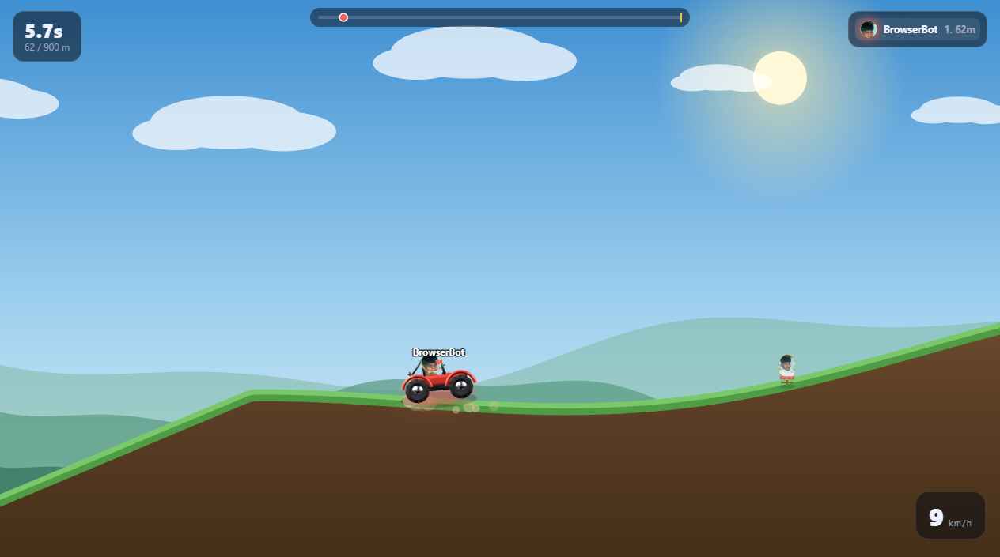

# Hill Climb MP

A 2&ndash;4 player hill-climb racer that runs in the browser. One shared, procedurally generated track, everyone on their own device, real-time over WebSockets.



## Features

- **2&ndash;4 players per room**, join by 4-letter room code from any phone, tablet or PC on the network
- **Server-authoritative physics** &mdash; the same `shared/physics.js` runs in Node and in the browser, so your own car is predicted locally (instant response) and reconciled against the server
- **Deterministic procedural tracks** &mdash; a seed generates identical terrain on every client; new seed every race
- **Arcade hill-climb handling** &mdash; gas/brake, air rotation, suspension, traction limits, auto flip recovery and checkpoints
- **Live HUD** &mdash; race timer, distance, speed, positions and a minimap
- **Touch controls** for phones, keyboard for desktop
- Zero build step, no external assets, no frameworks

## Run it

Requires Node.js 18+ (tested on Node 26).

```bash
npm install
npm start
```

The server prints both addresses:

```
Local:   http://localhost:3000
Network: http://192.168.1.3:3000
```

Open the **Network** address on every device that is on the same Wi-Fi, type a name, leave the room code empty for the first player, then share the 4-letter code with everyone else. The host presses **Start race**.

> Windows may ask to allow Node through the firewall the first time &mdash; allow it on private networks.

## Controls

| Action | Keyboard | Touch |
| --- | --- | --- |
| Gas | `→` / `D` | right button |
| Brake / reverse | `←` / `A` | left button |
| Reset to checkpoint | `R` | &mdash; |

In the air, gas rotates the car backwards and brake rotates it forwards. Land on your wheels.

## How it works

```
server/index.js      HTTP static server + WebSocket rooms, 60 Hz authoritative sim
shared/track.js      seeded track generator (used by server and browser)
shared/physics.js    car simulation (used by server and browser)
public/              UI, canvas renderer, client-side prediction & interpolation
tools/               physics, network and headless-browser tests
```

- Server ticks physics at a fixed 60 Hz and broadcasts snapshots at 20 Hz.
- Clients predict their own car locally and blend towards server snapshots; other cars are rendered ~110 ms in the past and interpolated.
- Rooms live in memory. Restarting the server clears them.

## Tests

```bash
npm run test:physics   # deterministic simulation sanity run
npm run test:net       # two WebSocket clients join, race, receive snapshots
npm run test:browser   # headless Chrome drives the real UI and screenshots it
```

`test:browser` needs Chrome installed (set `CHROME` to override the path) and writes screenshots to `shots/`.

## Deploying

The game is a long-running Node process with WebSockets, so it needs a host that keeps processes alive:

- **Railway / Render / Fly.io** &mdash; deploy this repo, start command `npm start`, expose the port via `PORT`. A `Dockerfile` is included, so any container host works.
- **Vercel** &mdash; can host the static client, but *not* the WebSocket game server (serverless functions cannot hold socket connections). Point the client at a separate server if you split them.
- **LAN / hotspot** &mdash; just `npm start` and share the Network URL, no deployment needed
- **Quick public link** &mdash; run the server and tunnel it without an account:

  ```bash
  cloudflared tunnel --url http://localhost:3000
  ```

  Share the printed `https://…trycloudflare.com` URL. The tunnel lives as long as the process runs.


## License

MIT
